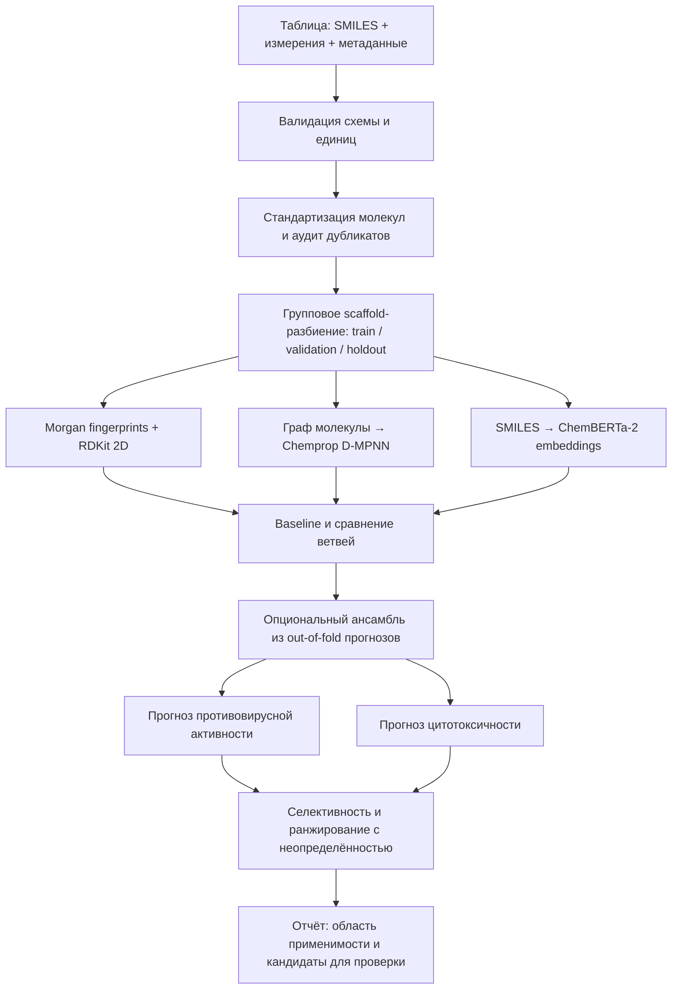

# VACV: прогноз индекса селективности по SMILES

Хакатон **Nuclear IT Hack**, задача Лаборатории хемоинформатики и молекулярного
моделирования ИИКС НИЯУ МИФИ. Срок — одна ночь.

## Задача

По SMILES-записи молекулы предсказать её индекс селективности против вируса
вакцинии (штамм VACV). Задача регрессии.

```
SI = CC50 / IC50
```

Отношение полумаксимальной концентрации цитотоксичности к полумаксимальной
концентрации ингибирования, обе в µM.

> Цель — **вирус вакцинии**, вакцинный и модельный штамм, а не variola virus.
> Рядом с каждым измерением фиксируем вирус, штамм, клеточную линию и протокол
> анализа. Прогноз — исследовательский вычислительный инструмент ранжирования:
> сам по себе он не доказывает ни эффективности, ни безопасности.

## Что сдаём

1. Код создания модели и её проверки.
2. Скрипт выгрузки данных из открытых баз: `smiles, IC50, CC50, SI, doi`, с
   валидацией и перечислением источников — см. `src/data/download.py` и
   `data/SOURCES.md`.
3. Саму собранную базу в этом формате — `data/processed/dataset.csv`.

**Условие допуска к защите.** Клон репозитория → запуск пайплайна → `.csv` →
загрузка в Kaggle → порядок метрики тот же. Если результат не воспроизводится,
на питч приглашают следующую команду по рейтингу. Поэтому воспроизводимость —
не последний пункт чеклиста, а постоянная обязанность D с первого часа.

## Запуск

Виртуальное окружение лежит **вне** репозитория, в родительской папке:

```bash
source ../env/Scripts/activate      # Git Bash
../env/Scripts/Activate.ps1         # PowerShell
pip install -r requirements.txt
```

Единая точка входа — один модуль, без скрытого состояния в чьей-то локальной
папке:

```bash
python -m src.pipeline data        # выгрузка, валидация, стандартизация   A
python -m src.pipeline splits      # scaffold-разбиение и манифест         B
python -m src.pipeline train       # обучение по configs/baseline.json     B C
python -m src.pipeline evaluate    # метрики на validation с интервалами   B D
python -m src.pipeline submission  # reports/submission.csv для Kaggle     D
python -m src.pipeline all         # всё, кроме выгрузки данных

python -m unittest discover -s tests -t . -v   # тесты и smoke-прогон
```

Те же команды есть в `Makefile` (`make data`, `make splits`, …) для тех, у кого
установлен make. На Windows его обычно нет — запускаем напрямую.

## Архитектура



Схема сравнительная: наличие трёх ветвей не означает, что все три попадут в
итоговую модель. Выбор делается по результату на одном и том же химически
независимом разбиении.

Две развилки решаются замером, а не заранее:

- считать `SI` из двух прогнозов, как на схеме (`two_head`), или предсказывать
  его одной головой (`direct`) — переключатель `model.strategy` в конфиге;
- объединять ветви конкатенацией признаков или ансамблем прогнозов.

## Структура репозитория

```
├── configs/baseline.json    конфиг прогона: seed, признаки, стратегия
├── data/
│   ├── raw/                 выгрузки из баз, не перезаписываются        A
│   ├── interim/             после стандартизации и дедупликации         A
│   ├── processed/           dataset.csv, splits.json, rejected.csv      A B
│   └── SOURCES.md           откуда качаем, запросы, лицензии            A
├── src/
│   ├── data/schema.py       контракт: колонки, единицы, цензурирование  A
│   ├── data/standardize.py  RDKit-стандартизация, агрегация дубликатов  A
│   ├── data/download.py     выгрузка из ChEMBL, PubChem, BindingDB      A
│   ├── features/            Morgan fingerprints, RDKit 2D дескрипторы   B
│   ├── splits.py            scaffold-split, манифест, тест на утечки    B
│   ├── models/baseline.py   direct и two_head стратегии                 B
│   ├── evaluate.py          метрики, бутстрап, область применимости     B D
│   └── pipeline.py          сквозной прогон до submission.csv           D
├── tests/                   по файлу на стадию, запускаются в CI        все
├── reports/                 метрики, отчёт, submission.csv              D
├── artifacts/               обученные модели                            D
├── Makefile
└── requirements.txt         пины версий
```

## План на ночь

Часы относительные, от начала работы. Внутри фазы треки идут параллельно.

| Часы | A — данные | B — baseline | C — тяжёлые модели | D — инфраструктура |
|---|---|---|---|---|
| 0–1 | **Контракт CSV: колонки, типы, единицы.** Это единственное, что блокирует всех сразу | смотрит стартовый датасет | проверяет, встают ли torch, chemprop, transformers и на каком Python | скелет готов, `unittest` зелёный |
| 1–5 | выгрузка ChEMBL, стандартизация, дедупликация | splits, признаки, baseline **на стартовом датасете**, первая отправка на Kaggle | отдельный venv на 3.11/3.12, smoke Chemprop на сотне молекул | `python -m src.pipeline all` работает, CI, первый чистый прогон из пустой папки |
| 5–8 | PubChem, нормализация единиц, DOI, финальная база | `direct` против `two_head`, настройка на validation | обучение Chemprop и ChemBERTa на тех же разбиениях | метрики с интервалами, калибровка, область применимости |
| 8–10 | база заморожена, заполняет `SOURCES.md` | отдаёт out-of-fold прогнозы | слияние: конкатенация против ансамбля на OOF | готовит релиз: пины, чексуммы, инструкция |
| 10–12 | — | код заморожен | код заморожен | **один** прогон на holdout, финальный сабмит, отчёт, чистый прогон |

### Что можно параллелить, а что нет

| Работа | Параллельно | Чего ждёт |
|---|---|---|
| Выгрузка данных | да | только контракта CSV |
| Scaffold-split | да | стартового датасета, не финального |
| Признаки и baseline | да | манифеста разбиения |
| Chemprop, ChemBERTa | да | своего venv и того же манифеста |
| Инфраструктура и CI | да | ничего, идёт с нуля |
| Слияние моделей | нет | out-of-fold прогнозов всех ветвей |
| Калибровка | нет | выбранной финальной модели |
| Holdout и релиз | нет | заморозки кода |

Параллельность держится на одном приёме: B, C и D с первого часа работают на
стартовом датасете по согласованному контракту, а когда A отдаёт расширенную
базу, прогоны просто перезапускаются — код не меняется. Если контракт не
зафиксировать в первый час, три трека встанут в ожидание A.

### Что режем первым, если не укладываемся

По порядку: fine-tuning ChemBERTa-2 → BindingDB → ансамбль → ChemBERTa целиком
→ Chemprop. Никогда не режем: выгрузку из ChEMBL, собранную базу, scaffold-split
и воспроизводимый прогон. Первые три — то, что прямо требует условие задачи,
последнее — то, по чему снимают с защиты.

## Правила, которые не отменяются из-за срока

- **Holdout трогаем один раз**, в самом конце, силами D. Ни гиперпараметров, ни
  порогов, ни весов ансамбля на нём.
- Все преобразования — масштабирование, отбор признаков, импутация — обучаются
  только на train.
- Scaffold-split по каркасам Мурко, фиксированный seed, манифест в репозитории.
  Тест на утечки стоит в CI: при утечке метрика выглядит отлично, а на закрытом
  тесте Kaggle результат рассыпается.
- Ансамбль обучается только на out-of-fold прогнозах.
- Ветвь входит в финальную модель только с подтверждённым приростом на
  validation. Иначе остаётся снаружи.
- Сырая таблица не перезаписывается. Причины исключения строк пишутся в
  `data/processed/rejected.csv` колонкой `reason`.
- Цензурированные значения (`>100 µM`, `<0.1`) представлены явно, а не
  приведены молча к числу.
- Метрики считаются в лог-пространстве: в линейном масштабе одна молекула с
  SI = 5000 определяет и RMSE, и знак улучшения.
- Разницу метрик подтверждаем бутстрапом. На двух сотнях молекул улучшение на
  0.02 неотличимо от шума.
