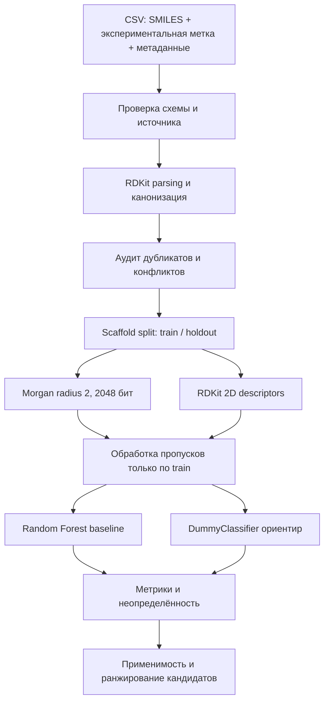

# VACV: базовая модель по SMILES (вариант QSARBioPred)

Эта ветка реализует первый вариант: молекула из SMILES преобразуется в Morgan fingerprints и дескрипторы RDKit, после чего модель Random Forest оценивает экспериментальную метку противовирусной активности. Ветвь `alt` предназначена для разработки baseline и его проверки; целевые данные должны относиться именно к VACV и содержать прослеживаемые условия эксперимента.

> VACV — вирус вакцинии, не variola virus. Клеточная активность и прогноз модели не подтверждают безопасность или эффективность препарата у человека.

## План работ и ворота качества

Каждый этап выполняется отдельной задачей в своей ветке/PR. Переход дальше возможен только после прохождения тестов и критериев приёмки данного этапа.

| Этап | Изолированная задача | Результат | Проверки перед переходом |
|---|---|---|---|
| 1. Контракт набора | Описать столбцы SMILES, метки, источники, штамм, клеточную линию, единицы и правила включения | Схема входной таблицы и документация происхождения данных | Тест схемы проверяет обязательные поля, типы значений, пропуски и допустимые метки; реальные результаты не подменяются примерами |
| 2. SMILES и структура | Канонизировать валидные структуры, выявить дубликаты и противоречивые метки | Воспроизводимый разбор молекул и журнал отбраковки | Unit-тесты для валидных/невалидных SMILES, эквивалентных записей, дубликатов и конфликтов |
| 3. Признаки baseline | Рассчитать Morgan radius 2 (2048 бит) и фиксированный набор RDKit 2D дескрипторов | Матрица признаков, готовая для классических моделей | Проверить размерность, конечность/обработку пропусков, стабильность порядка столбцов и соответствие каждой строки молекуле |
| 4. Разбиение | Разделить соединения по Bemis–Murcko scaffold на train и holdout; зафиксировать seed и индексы | Повторяемое химически групповое разбиение | Тест доказывает отсутствие одинаковых канонических структур и scaffolds между частями; тестовая часть не используется при обучении или подборе признаков |
| 5. Обучение | Обучить Random Forest baseline; сравнить с простым DummyClassifier и, отдельной задачей, SVM/XGBoost | Версионируемый pipeline и предсказания | Smoke-тест полного обучения, проверки обеих меток в обучении и воспроизводимости seed; подбор параметров только внутри train |
| 6. Оценка | Рассчитать PR-AUC, ROC-AUC по вероятностям, MCC, чувствительность и специфичность | Отчёт с размером и составом выборки, интервалами неопределённости и ошибками по scaffold | Holdout открывается один раз после фиксации pipeline; отдельный тест проверяет метрики на известном игрушечном примере |
| 7. Применимость | Оценить близость новых соединений к обучающей выборке и калибровку вероятностей | Ранжирование с указанием неопределённости и выхода за область применимости | Тесты для неизвестных/невалидных молекул и правила abstain; прогноз вне области применимости помечается |
| 8. Выпуск | Зафиксировать версии зависимостей, данные/хеши, split, модель и команду воспроизведения | Отчёт и воспроизводимый запуск | Полный набор тестов и чистый повторный запуск обучения/инференса проходят в CI |

Провал теста блокирует переход к следующему этапу: исправляется текущая изолированная задача. Holdout не применяется для feature selection, настройки гиперпараметров или выбора порога.

## Архитектура



## Смысл и ограничения модели

В отличие от механического копирования ноутбука QSARBioPred, здесь данные не извлекаются автоматически из ChEMBL для другого организма и другого типа измерений. Модель обучается только на переданной таблице с VACV-метками. Если в таблице есть только SMILES, обучить прогноз активности нельзя: нужны наблюдаемые экспериментальные метки.

Первая версия поддерживает бинарную метку `0/1`. Порог активности должен быть определён по экспериментальному протоколу до анализа результатов. Для количественных EC₅₀/IC₅₀ и CC₅₀ потребуется отдельная регрессионная задача и данные цитотоксичности; одна метка активности не позволяет оценить селективность.

## Структура

```text
README.md
pyproject.toml
src/vacv/baseline.py     # parsing, признаки, scaffold split, RF и метрики
tests/test_baseline.py   # unit-тесты и проверка отсутствия scaffold-пересечений
data/                    # локальные исходные данные; не коммитить без проверки лицензии
reports/                 # отчёты и графики
```

## Локальный запуск проверок

```powershell
python -m pip install -e ".[test]"
python -m pytest
```

## Интерпретация результата

Эта ветка создаёт только воспроизводимую основу для сравнения и ранжирования исследовательских кандидатов. Значения метрик нельзя сообщать до обучения на реальных VACV-данных и независимой проверки. Модель не заменяет лабораторный анализ и не предсказывает клиническую безопасность.
