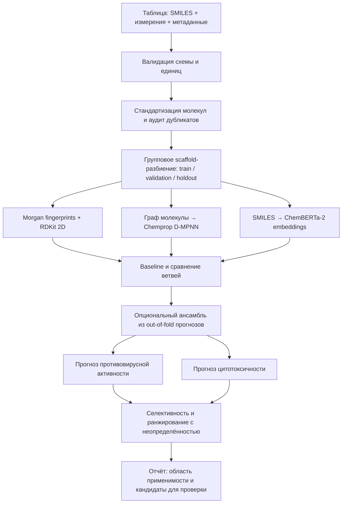

# VACV: прогноз противовирусной активности и цитотоксичности

## Цель проекта

Разработать воспроизводимую модель, которая по структуре соединения (SMILES) оценивает его активность против вируса вакцинии (VACV) и цитотоксичность в клеточном тесте. Итоговый приоритет кандидата должен учитывать оба свойства и неопределённость прогноза.

> VACV — вирус вакцинии, а не variola virus (возбудитель натуральной оспы). В README и данных необходимо указывать конкретный вирус, штамм, клеточную линию и протокол анализа. Компьютерный прогноз является исследовательским инструментом и сам по себе не доказывает эффективность или безопасность для человека.

## План разработки и обязательные ворота качества

Работа ведётся последовательно. Каждый этап — отдельная задача/изолированный набор изменений (предпочтительно отдельная ветка или PR). Следующий этап начинается только после прохождения перечисленных проверок предыдущего. Все проверки запускаются автоматически в CI; команда и ожидаемый результат документируются в соответствующем PR.

| Этап | Изолированная задача | Результат | Условие перехода |
|---|---|---|---|
| 0. Контракт данных | Зафиксировать формат таблицы, единицы, типы измерений, критерии включения и источники | Спецификация данных и пример CSV без вымышленных результатов | Проверка схемы отклоняет отсутствующие поля, некорректные единицы и нечисловые значения; граничные и цензурированные значения явно поддержаны |
| 1. Загрузка и очистка | Разобрать SMILES, стандартизовать структуру, выявить дубликаты и конфликтующие измерения | Повторяемый preprocessing с журналом причин исключения строк | Тесты на валидные/невалидные SMILES, соли, дубликаты, единицы и пропуски; исходная таблица не перезаписывается |
| 2. Разделение и утечки | Создать фиксированные train/validation/test разбиения по химическим каркасам; закрепить seed и манифест | Версионированные индексы разбиений и отчёт о пересечении структур | Тест подтверждает отсутствие одинаковых стандартизованных молекул и каркасов между частями; преобразования обучаются только на train |
| 3. Базовые признаки | Рассчитать Morgan fingerprints и RDKit 2D дескрипторы; обучить простые baseline-модели | Базовые прогнозы активности и цитотоксичности | Unit-тесты признаков и smoke-тест полного обучения; метрики на validation рассчитаны из вероятностей/непрерывных значений корректно |
| 4. Базовая оценка | Настроить параметры только на train/validation, выбрать метрики и пороги | Отчёт с доверительными интервалами и ошибками по химическим сериям | Тест фиксированного разбиения; holdout не использован для подбора параметров или порога |
| 5. Chemprop | Добавить графовую D-MPNN как отдельную ветвь | Сравнение с baseline на тех же разбиениях | Тесты входов/выходов, воспроизводимый smoke-тест; улучшение подтверждено на validation, иначе ветвь не включается в итоговую модель |
| 6. ChemBERTa-2 | Добавить замороженные эмбеддинги; fine-tuning оценивать отдельной задачей | Сравнение эмбеддингов и, при достаточных данных, fine-tuning | Тесты загрузки модели, токенизации и воспроизводимости; никакого обучения/подгонки на test |
| 7. Слияние моделей | Сравнить конкатенацию признаков с ансамблем прогнозов | Обоснованная финальная архитектура | Слияние обучается только на out-of-fold прогнозах; тест показывает устойчивый выигрыш над лучшим одиночным baseline |
| 8. Калибровка и область применимости | Оценить калибровку вероятностей, неопределённость и сходство с обучающими молекулами | Предупреждение для экстраполяций и ранжирование кандидатов | Тесты на неизвестные/невалидные входы, пороги abstain и отчёт о калибровке |
| 9. Независимая проверка и выпуск | Один раз оценить зафиксированную модель на holdout; сохранить артефакты и окружение | Версия модели, отчёт, инструкция запуска и контрольные суммы | Все тесты CI зелёные; отчёт содержит состав данных, split, метрики, ограничения и точную версию модели |

Каждый этап должен добавлять или менять только свой ограниченный набор файлов, иметь собственные тесты и критерии приёмки. При провале ворот исправляется текущая задача; результаты не объявляются успешными и переход к следующему этапу не выполняется.

## Архитектура



Архитектура сравнительная: наличие нескольких ветвей не означает, что все они попадут в итоговую модель. Выбор делается по результату на одинаковом, химически независимом разбиении.

## Целевые показатели

Предпочтительны исходные количественные измерения при известной концентрации и протоколе. Например, EC₅₀/IC₅₀ для подавления VACV и CC₅₀ для цитотоксичности. При согласованных единицах можно моделировать `pEC50 = -log10(EC50 [M])` и `pCC50 = -log10(CC50 [M])`; тогда `log10(SI) = pEC50 - pCC50`, где `SI = CC50 / EC50`. Активность и цитотоксичность обучаются как отдельные цели: пропуск одного результата не превращается в отрицательную метку другого.

Если доступны только бинарные метки, заранее фиксируются источник, порог и правила обработки пограничных значений. Не смешивать результаты разных штаммов, клеточных линий, методов и единиц без явной нормализации и анализа источникового эффекта. Для значения вида `>x` или `<x` хранить знак цензурирования, а не приравнивать его к точному `x`.

## Оценка качества

- Регрессия: MAE и RMSE в логарифмической шкале, интервалы неопределённости и ошибки по scaffold/источникам.
- Классификация: PR-AUC, ROC-AUC по вероятностям, MCC, чувствительность и специфичность при заранее выбранном пороге.
- Основной тест — групповое разделение по scaffold; случайное разделение допускается только как дополнительный диагностический результат.
- Все этапы подготовки признаков, отбора, настройки гиперпараметров, выбора порога и слияния выполняются внутри train/validation.
- Holdout используется однократно после фиксации модели. Публикуются число соединений, число каркасов, баланс меток, доверительные интервалы и ограничения области применимости.

## Предлагаемая структура репозитория

```text
.
├── README.md
├── data/                 # исходные данные вне Git; в репозитории только схема/пример
├── configs/              # фиксированные параметры и разбиения
├── src/vacv/             # загрузка, стандартизация, признаки, обучение, оценка, inference
├── tests/                # unit, data validation, leakage и smoke-тесты
├── reports/              # генерируемые отчёты и графики
├── models/               # версионируемые итоговые артефакты или ссылки на них
└── pyproject.toml        # зависимости и команды проекта
```

До появления реальной таблицы и описания протоколов обучение и метрики не заявляются. Секреты, персональные данные и большие исходные наборы не коммитятся; для каждого набора фиксируются источник, лицензия и контрольная сумма.

## Критерий готовности проекта

Проект готов к исследовательскому применению, когда новый пользователь может воспроизвести подготовку данных, тесты, обучение и отчёт по инструкциям; результат включает оба целевых показателя, оценку неопределённости и явное предупреждение для молекул вне области применимости. Прогнозы служат для приоритизации последующих лабораторных проверок.
